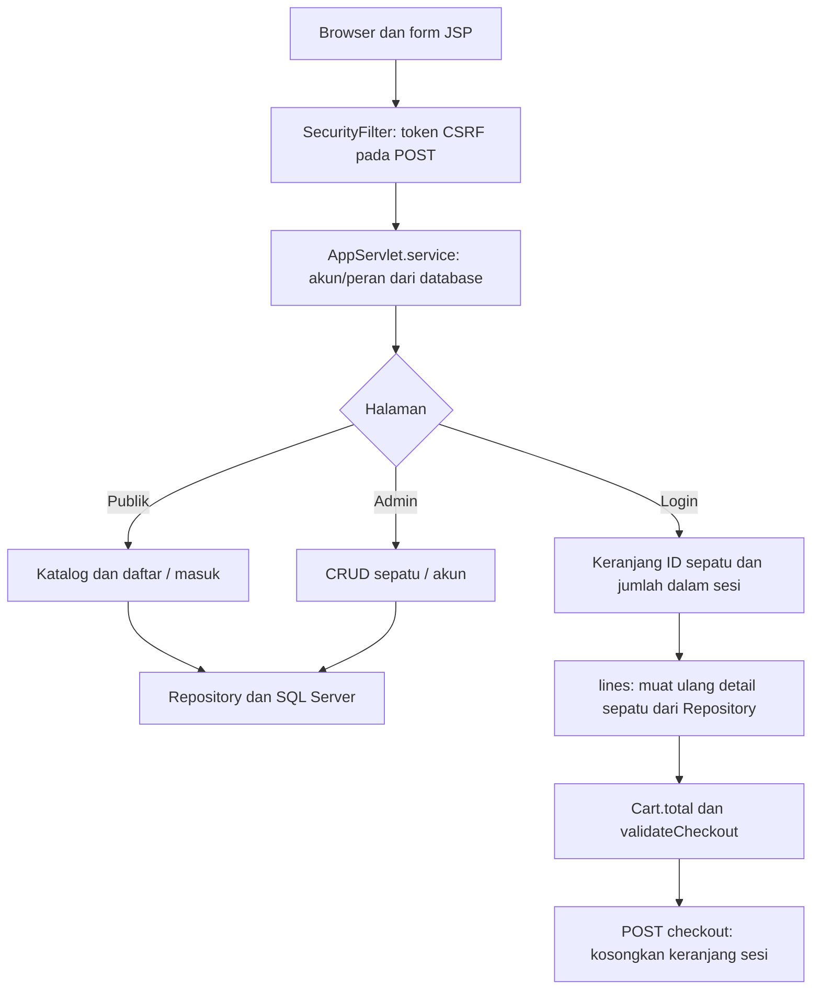

# Alur kode ShoeStore Web Java

Katalog sepatu dan akun disimpan di SQL Server melalui Servlet/JSP dan JDBC. Keranjang disimpan dalam HttpSession di server. Checkout memeriksa ulang isi keranjang lalu mengosongkannya sebagai simulasi; tidak ada order, pembayaran, pengiriman, atau pengurangan stok database.

## Request, akun, dan akses

[`AppServlet`](../src/main/java/id/shoestore/AppServlet.java) memetakan path aplikasi, meneruskan aset ke servlet bawaan Tomcat, serta melayani `/health`. Untuk request aplikasi, `current()` mengambil ulang akun berdasarkan `accountId` sesi; penghapusan/perubahan peran akun berlaku pada request berikutnya.

Katalog dapat dibuka tanpa login. Path `/cart`, `/checkout`, dan `/admin` memerlukan akun; path admin juga memerlukan peran admin. Registrasi memakai `Validation`, membuat akun `user` dengan hash `Passwords`, kemudian login otomatis. `signIn()` membatalkan sesi lama dan membuat sesi baru; keluar membatalkan sesi, termasuk keranjang.

[`SecurityFilter`](../src/main/java/id/shoestore/SecurityFilter.java) menyiapkan token CSRF dan memeriksanya pada POST. Controller tetap bertanggung jawab atas hak akses. View berada dalam `WEB-INF/views`; parameter pengguna tidak dipakai sebagai nama JSP bebas.

## Katalog dan keranjang sesi

[`Repository.shoes()`](../src/main/java/id/shoestore/Repository.java) memuat produk; setiap record mewakili satu ukuran. POST `/cart/add` memvalidasi ID/jumlah, mengambil sepatu dari database, lalu memakai [`Cart.add()`](../src/main/java/id/shoestore/Cart.java). Batasnya 20 jenis produk dan 50 pasang per record, dengan jumlah tidak melebihi stok yang dibaca. Perubahan keranjang disinkronkan pada objek sesi.

Sesi menyimpan ID sepatu dan jumlah, bukan harga kiriman browser. `lines()` mengambil ulang record untuk setiap ID saat keranjang/checkout dibaca. Produk yang dihapus ditampilkan sebagai tidak tersedia. `Cart.total()` memakai BigDecimal; stok dan informasi produk yang berubah ikut diperiksa saat `validateCheckout()` dijalankan.

[`checkout.jsp`](../src/main/webapp/WEB-INF/views/checkout.jsp) mengirim POST `/checkout` dengan token CSRF. Controller memeriksa baris, kemudian mengganti map keranjang dengan map kosong. Tidak ada insert transaksi atau update stok. Ini juga tidak menahan stok secara eksklusif untuk sesi tersebut. Data keranjang hanya bertahan selama sesi, bukan database atau localStorage.

## CRUD admin dan transaksi tertentu

Admin mengirim POST `/admin/save` atau `/admin/delete` setelah halaman form/konfirmasi. `Validation` memeriksa data, termasuk harga, ukuran, stok, gambar, dan jenis `shoes|accounts`. Repository menggunakan prepared statement dan nama tabel dari jenis yang dibatasi.

`saveShoe()` serta pembuatan akun memakai statement autocommit. Perubahan akun yang sudah ada dan penghapusan memakai transaksi eksplisit. `guardLastAdmin()` mengunci baris admin dengan `UPDLOCK,HOLDLOCK` sebelum mengizinkan penghapusan/penurunan peran. Perlindungan admin terakhir ini bukan mekanisme versi untuk edit semua sepatu atau penyimpanan order.

## Startup, kegagalan, dan batas layanan

[`Bootstrap`](../src/main/java/id/shoestore/Bootstrap.java) membuat admin dari environment hanya jika belum ada admin. [`database/schema.sql`](../database/schema.sql) dan init Compose menyiapkan SQL Server serta akun aplikasi; source ini bukan dump database lama. Koneksi/read statement ditutup dengan try-with-resources.

Validasi gagal menghasilkan form/halaman 400; akses terlarang 403; data/halaman hilang 404; database tidak tersedia 503. Penulisan tidak dikirim ulang otomatis. Jika hasil query tulis tidak pasti akibat koneksi terputus, periksa daftar sebelum mengulang, karena tidak ada kunci deduplikasi bisnis. Akun/admin serta katalog persisten, sedangkan hasil checkout simulasi tidak menciptakan riwayat transaksi.
